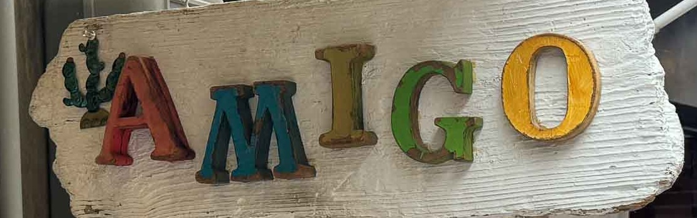

# AMIGO

AMIGO: Aperture Masking Interferometry Generative Observations. An end-to-end differentiable modelling pipeline for the JWST Interferometer.

The [documentation](https://louisdesdoigts.github.io/amigo/) is currently under development, however we currently provide:

- 📦 [Example Notebooks](https://github.com/LouisDesdoigts/amigo_notebooks), showing a basic overview of how to run the Amgio pipeline
- 📦 [Calibration Files](https://github.com/LouisDesdoigts/amigo_files) that are hosted on this git large file storage repo

We also have some publications that are currently available on arxiv:
- 📄 [Amigo Paper](https://arxiv.org/abs/2510.09806) (cite this if you use Amigo!)
- 📄 [Amigo Image Reconstruction Paper](https://arxiv.org/abs/2510.10924)

If you have any questions or need help, feel free to open an issue on the GitHub repository or reach out to the community.

## Virgil integration and tests

Install `amigo[virgil]` to use `amigo.discos.to_virgil`. Virgil remains optional
for extraction-only use. For a source checkout, `pip install -e '.[dev]'`
includes Virgil because the test suite exercises the native handoff:

```sh
python -m pytest tests/test_disco.py -k native_virgil_handoff
```


